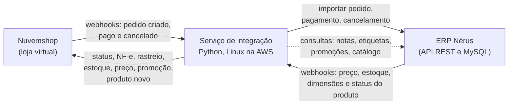

# 🔗 Integração E-commerce x ERP, estudo de caso

> Integração entre a plataforma Nuvemshop e o ERP Nérus em uma loja de varejo com loja física, e-commerce e cursos. Cerca de 1.600 pedidos por mês (pico de 3.700 na Páscoa) e 5.250 SKUs sincronizados, com webhooks nos dois sentidos, HTTPS, fila de retentativas, reconciliação automática e alertas. Desenvolvida conforme os requisitos de homologação da Nuvemshop, com o processo de homologação em andamento.

> ℹ️ Este repositório é um **estudo de caso de arquitetura**, sem código. A integração é propriedade da empresa onde foi desenvolvida e está em produção. Nomes de servidores, tabelas, endpoints internos, identificadores e credenciais foram omitidos de propósito. Os padrões de código usados na integração estão reescritos de forma genérica, com dados fictícios e testes automatizados, no repositório [padroes-integracao-python](https://github.com/heberthaugusto/padroes-integracao-python).

---

## 🎯 O contexto

A loja já tinha uma integração entre o ERP e a plataforma de e-commerce anterior, baseada em API REST e consultas periódicas (polling), sem HTTPS e sem webhooks. Ela cobria pedidos, estoque, nota fiscal, rastreio, cancelamento e cadastro de produto novo, mas tudo dependia de varreduras em intervalos fixos, e alguns casos ficavam com a equipe: a mudança de status de pedidos refeitos no ERP e os pedidos mistos (produto e curso juntos) não tinham tratamento automático. Também não havia alertas por e-mail, então uma pendência só era descoberta quando alguém olhava.

Quando a loja migrou o e-commerce para a Nuvemshop, a integração precisou ser refeita. A decisão foi aproveitar a troca para subir o nível da infraestrutura (HTTPS, webhooks nos dois sentidos, serviços gerenciados pelo sistema operacional), deixar os cadastros mais corretos e automatizar o que ainda era manual. A integração foi desenvolvida internamente, do zero, seguindo os requisitos de homologação da Nuvemshop, cujo processo está em andamento.

---

## 🏗️ Arquitetura

Dentro do serviço de integração:

- **nginx com HTTPS** na frente de uma aplicação **Flask** que recebe os webhooks dos dois lados, rodando em um ambiente Python isolado (venv);
- **threads de fundo** para o que não chega por webhook: polling de NF-e, NFS-e e rastreio, fila de retentativas, reconciliação, fila de estoque pendente e relógio das promoções;
- **serviços agendados** separados: varredura completa do catálogo duas vezes por dia, criação de produto novo e alertas por e-mail;
- **estado em arquivos JSON**: mapa de pedidos (o que já foi feito com cada pedido), filas e agenda de promoções.

O serviço roda em um servidor Linux na AWS, ao lado do ERP, como serviços do sistema (systemd), com credenciais em variáveis de ambiente. Toda mudança é validada antes no ambiente de teste do ERP, uma réplica da base de produção.

**Dois tipos de evento chegam por webhook:** a Nuvemshop avisa pedido criado, pago e cancelado; o ERP avisa quando um produto muda (preço, estoque, dimensões ou a flag que tira o produto do site). O aviso do ERP não traz o valor, só diz o que mudou, e a integração consulta a API para buscar o valor atual.

**O que o webhook não cobre, polling cobre:** o ERP não emite evento de nota fiscal emitida, etiqueta gerada ou promoção iniciada, então esses fluxos rodam em threads de fundo em intervalos curtos. Uma varredura completa do catálogo, duas vezes por dia, funciona como rede de segurança para qualquer evento perdido.

---

## 🔄 Os fluxos

### 1. Pedido (Nuvemshop → ERP)
1. Webhook de pedido chega. Uma trava por pedido garante que dois webhooks quase simultâneos (criado e pago, comum no Pix) não importem o pedido duas vezes.
2. O cliente é localizado no ERP pelo documento. Se existe, o cadastro é reaproveitado e o nome nunca é sobrescrito, para ninguém alterar o cadastro de outra pessoa fazendo um pedido com o mesmo CPF. Cliente pessoa jurídica entra com a razão social, exigência da nota fiscal. Compra sem login usa os dados de contato do pedido.
3. Endereço é saneado: campos vazios ou "Não informado" são completados pelo endereço de cobrança, e apóstrofos são removidos porque o ERP rejeita a nota com eles.
4. Frete é mapeado para transportadora e serviço dos Correios pelo código do frete, com leitura pelo nome como reserva. Retirada na loja, nativa ou por frete personalizado, entra sem transportadora.
5. Forma de pagamento e parcelas são mapeadas para o ERP, com regra própria para o meio de pagamento da plataforma.
6. Pedido de produto e pedido de curso entram em PDVs diferentes, porque curso gera NFS-e e produto gera NF-e. **Pedido misto** (produto e curso juntos) é dividido automaticamente em dois pedidos no ERP, com o frete no de produto e o desconto rateado. Se a soma não bater, não divide e avisa.
7. Pagamento aprovado e cancelamento atualizam o pedido no ERP. A data real do pagamento é gravada para o fechamento de cartões.

### 2. Produto (ERP → Nuvemshop)
- **Estoque:** o saldo enviado já desconta reservas. Redução sincroniza na hora. Aumento (recebimento de mercadoria) espera 1h30 em uma fila, para a precificação e a conferência acontecerem antes de o produto voltar ao site. Se o ERP estiver fora, o SKU fica na fila e é tentado a cada 5 minutos.
- **Preço:** sempre o preço normal. Preço zero nunca é enviado.
- **Promoção agendada (de/por):** a promoção cadastrada no ERP, com data e hora de início e fim, é lida a cada 5 minutos e aplicada e retirada no minuto certo pela integração, que também coloca e tira o produto da categoria Ofertas do site. A retirada só é dada como feita depois que a plataforma confirma.
- **Produto novo:** produtos cadastrados no ERP são criados na Nuvemshop duas vezes por dia, como físico ou digital conforme o tipo, com a tag do SKU, e a equipe recebe um e-mail com os links para revisar.
- **Produto fora do site:** uma flag no ERP tira o produto da integração. A checagem é feita a cada evento, consultando o banco, em vez de uma lista em memória que poderia ficar desatualizada.

### 3. Nota fiscal, status e rastreio (ERP → Nuvemshop)
- Quando a NF-e é emitida, o XML é enviado à Nuvemshop e o pedido passa a Embalado.
- Quando a etiqueta dos Correios é gerada, o código de rastreio vai para a plataforma e o pedido passa a Enviado. A plataforma marca Entregue sozinha.
- Pedido de curso, sem envio, vai direto a Entregue quando a NFS-e é emitida.
- **Pedido refeito:** quando a equipe refaz um pedido no ERP, a nota sai no pedido novo. A integração localiza o pedido refeito pela observação, religa o vínculo e marca o status certo, sem mandar nota errada ao cliente. Se achar mais de um candidato, não escolhe e alerta.

### 4. Reconciliação e alertas
- Ao iniciar e a cada 6 horas, a reconciliação relê os pedidos dos últimos 4 dias e corrige o que o webhook perdeu, inclusive cancelamentos feitos com o servidor desligado.
- Todo dia útil de manhã, um e-mail de pendências vai para a operação (pedidos refeitos com original em aberto) e outro para TI e financeiro (pedidos sem nota há 4 dias ou mais, fila de retentativas, pedidos sem vínculo). Só sai e-mail quando há o que relatar.
- Pedido misto dividido gera e-mail para administrativo e financeiro com os dois pedidos e os valores.

---

## 🧠 Decisões técnicas

| Decisão | Alternativa | Por quê |
|---|---|---|
| **Webhooks nos dois sentidos** | Polling, como na integração anterior | Pedido e alteração de produto refletem em segundos e sem consumir cota de API à toa. Polling ficou como rede de segurança. |
| **HTTPS com nginx na frente da aplicação** | HTTP em porta alternativa | Exigência da plataforma para webhooks e proteção do tráfego. Também eliminou conflitos de porta com outros serviços do ERP. |
| **Trava por pedido e mapa de pedidos (idempotência)** | Confiar na ordem dos webhooks | O primeiro bug em produção foi um pedido duplicado por dois webhooks quase simultâneos. Com trava e mapa, reprocessar nunca duplica. |
| **Fila de retentativas em disco** | Fila externa (RabbitMQ, SQS) | O volume não justifica a infraestrutura. Fila em arquivo com reprocessamento periódico cobre indisponibilidade dos dois lados. |
| **Reconciliação periódica** | Confiar só no webhook | Webhook pode se perder (servidor desligado, rede). A reconciliação relê a janela recente e corrige sem chamada extra à plataforma. |
| **Espera de 1h30 no aumento de estoque** | Sincronizar na hora | Recebimento passa por precificação e conferência. Regra aprovada com a área de negócio. |
| **Promoção lida do banco, não da API** | Esperar a API do ERP | A API do ERP não reflete a promoção da precificação e não há evento de início e fim. Decidido com o responsável técnico do ERP, com caminho de volta para a API documentado. |
| **Checagem no banco a cada evento** | Lista em memória de produtos bloqueados | Consulta por chave primária é barata, e a lista poderia ficar desatualizada em reinício ou webhook perdido. |
| **Janela de funcionamento do ERP** | Tentar sempre | O servidor do ERP desliga à noite e no domingo. Fora da janela as rotinas não tentam, o log fica limpo e falha dentro da janela vira erro de verdade. |
| **Ambiente de teste com réplica do ERP** | Testar em produção | Toda mudança roda na réplica antes. Backup da versão anterior a cada implantação. |
| **Credenciais em variáveis de ambiente** | No código | Nada sensível no código, o que também permitiu documentar a integração sem expor acessos. |
| **Ambiente Python isolado (venv)** | Python do sistema | O servidor é compartilhado com o ERP e outros serviços. Com o venv, as dependências da integração não conflitam com as do restante do servidor e uma atualização de biblioteca não derruba nada fora dela. |

---

## 🛡️ Confiabilidade e operação

- **Nunca perde pedido:** falha vira retentativa, retentativa esgotada vira alerta, alerta vira ação da equipe com o número do pedido.
- **Nunca duplica:** trava por pedido, mapa de pedidos e tratamento de resposta "já cadastrado" do ERP como sucesso.
- **Nunca entra em loop:** pedido recusado pelo antifraude é dispensado antes de importar. Resposta da plataforma de "status já é esse ou mais avançado" é tratada como sucesso. Duas lições de produção, quando pedidos chegaram a milhares de tentativas.
- **Auto-cura:** se a importação é recusada porque o pedido já existe no ERP, a integração localiza e religa o pedido, inclusive quando é misto.
- **Logs por pedido**, com um registro por motivo e não um por tentativa, e classificação por janela de funcionamento.
- **Ferramentas de suporte** para os casos que ficam com a equipe (marcar pedido tratado manualmente, vincular refeitos, diagnosticar notas pendentes, completar datas de pagamento), todas com modo de simulação antes de aplicar.
- **Documentação técnica viva**, atualizada a cada mudança, com regras de negócio, problemas resolvidos e decisões, para quem der suporte depois.

---

## 📈 Efeito indireto

Com o pedido do site dentro do ERP com a data real de pagamento, foi possível automatizar o fechamento de cartões, cerca de 5 mil transações por mês que antes exigiam ajuste manual diário.

---

## 📚 Lições aprendidas

- **Idempotência primeiro:** o primeiro incidente foi pedido duplicado por dois webhooks quase juntos. Trava e mapa de pedidos resolveram e nunca mais aconteceu.
- **Loop infinito é o erro mais caro:** pedido recusado pelo antifraude e resposta "já está nesse status" chegaram a milhares de tentativas. Toda retentativa precisa de uma condição de desistência.
- **Nem tudo deve ser em tempo real:** a espera no aumento de estoque parece estranha no papel, mas foi a regra que mais evitou venda de produto não conferido.
- **A API do outro lado define o desenho:** promoção veio do banco porque a API do ERP não a refletia, e nota de serviço não entra na plataforma porque a tela mostrava número errado. Também aprendi a não confiar só na resposta da gravação: a plataforma já respondeu sucesso sem aplicar a mudança e já devolveu dado antigo logo após gravar, por isso a integração confere com uma nova leitura depois de cada escrita importante. Documentar o porquê de cada escolha evita que alguém "corrija" depois.
- **Dado de cliente é hostil por natureza:** apóstrofo em endereço, "Não informado" como texto, compra sem login, ponto e vírgula em nome de curso. Cada um derrubou uma nota fiscal antes de virar regra.
- **Documentar para quem opera:** a equipe tem convenções simples (como escrever "Pedido refeito NNNNNN" na observação) e manuais do que fazer quando um alerta chega.

---

## 🛠️ Stack

Python (Flask, gunicorn) · nginx com HTTPS · systemd · APIs REST · Webhooks · MySQL · Shell Script e cron · Linux (AWS) · Nuvemshop (API, webhooks e processo de homologação) · ERP Nérus (API e webhooks via hub)

---

## 🧩 Código relacionado

Os padrões usados nesta integração (receptor de webhooks com assinatura, lock por pedido, fila de retentativas, sincronização com espera, agenda de promoções, divisão de pedido misto e status idempotente) estão reescritos de forma genérica e com testes em [padroes-integracao-python](https://github.com/heberthaugusto/padroes-integracao-python).

---

## 👤 Autor

**Heberth Augusto**

*Desenvolvida com IA generativa (Claude) como ferramenta de trabalho, com especificação, revisão do código gerado, testes em ambiente de homologação e documentação antes de cada versão em produção.*
